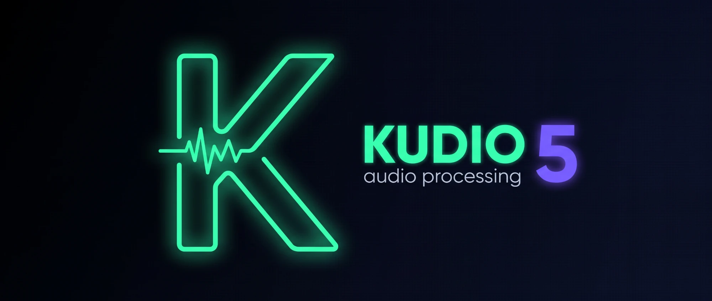

# Kudio

[](https://recklight.github.io/Kudio/)

[](https://pypi.org/project/kudio/)
[](https://pypi.org/project/kudio/)
[](LICENSE.txt)
[](https://recklight.github.io/Kudio/)
[](https://doi.org/10.5281/zenodo.24219274)

Kudio is a Python library for audio, speech most of all: files, features,
effects, rooms and phone lines, noisy-data synthesis, denoising, recording, and
the metrics speech papers report. Most of it is functions over a numpy array
and a sample rate.

The [documentation](https://recklight.github.io/Kudio/) has a guide to each
part, the API reference, and
[how each metric is checked](https://recklight.github.io/Kudio/validation/)
against its reference implementation.

## Install

```bash
pip install kudio
```

Python 3.9 or newer. The core install is numpy, scipy, soundfile, soxr, PyYAML
and tqdm, and reads WAV, FLAC, OGG, MP3 and AIFF. The extras:

| Extra | Adds |
|---|---|
| `audio` | recording and playback (sounddevice) |
| `pesq` | PESQ; PyPI has `pesq` as source only, so it needs a C compiler |
| `dnsmos` | DNSMOS P.835 and P.808 (onnxruntime; the weights come from Microsoft's DNS-Challenge) |
| `viz` | plotting helpers (matplotlib) |
| `data` | dataframes and Excel export (pandas, openpyxl) |
| `compressed` | m4a, aac and webm (audioread, with ffmpeg on the PATH) |
| `all` | all of the above except `pesq` |

```bash
pip install "kudio[audio,viz]"
```

## Quick start

A clean signal, the same under white noise, then a check, a denoiser and a
score:

```python
import numpy as np
import kudio

sr = 16000
t = np.arange(4 * sr) / sr
phase = 2 * np.pi * np.cumsum(120 + 20 * np.sin(np.pi * t)) / sr
voice = sum(np.sin(k * phase) / k for k in range(1, 20))
clean = (0.1 * voice * np.clip(np.sin(3 * np.pi * t), 0, None)).astype(np.float32)
noisy = kudio.add_noise_snr(clean, np.random.default_rng(7).standard_normal(len(t)),
                            snr_db=0, seed=0)
kudio.save_wave("noisy.wav", noisy, sr)

y, sr = kudio.file_load("noisy.wav")            # float32, at the file's own rate
print(kudio.audio_report(y, sr))                # no clean reference needed
denoised = kudio.spectral_enhance(y, sr)        # log-MMSE over an MCRA noise estimate
s = kudio.score(clean, denoised, sr, ["si_sdr", "stoi"])
print(f"SI-SDR {s['si_sdr']:.2f} dB, STOI {s['stoi']:.3f}")
kudio.save_wave("denoised.wav", denoised, sr)
```

```text
4.00s @ 16000 Hz · peak -10.1 dBFS · -22.8 LUFS · SNR~7 dB · bandwidth 8000 Hz
SI-SDR 8.34 dB, STOI 0.725
```

## What is in it

| Part | Functions |
|---|---|
| [Files](https://recklight.github.io/Kudio/guide/audio-files/) | `file_load`, `save_wave`, `audio_info`, `resample`, `convert_folder` |
| [Features](https://recklight.github.io/Kudio/guide/features/) | `STFT`, `waveform_to_spectrogram`, `mfcc`, `melspectrogram`, `stack_context`, `Standardizer` |
| [Inspection](https://recklight.github.io/Kudio/guide/inspection/) | `audio_report`, `loudness`, `normalize_lufs`, `true_peak`, `srmr`, `wada_snr`, `dnsmos` |
| [Speech and pitch](https://recklight.github.io/Kudio/guide/speech/) | `vad`, `vad_split`, `f0`, `save_labels` |
| [Editing and effects](https://recklight.github.io/Kudio/guide/editing/) | `fade`, `highpass`, `splice`, `trim_silence`, `pitch_shift`, `add_noise_snr`, `spec_augment` |
| [Rooms and channels](https://recklight.github.io/Kudio/guide/degradation/) | `rir`, `apply_rir`, `rt60`, `telephone`, `dropouts`, `apply_channel` |
| [Noisy datasets](https://recklight.github.io/Kudio/guide/synthesis/) | `Synthesizer`, `save_manifest`, `load_manifest`, `split_pairs` |
| [Denoising](https://recklight.github.io/Kudio/guide/enhancement/) | `spectral_enhance` (seven gain rules, four noise estimators), `StreamEnhancer`, `compare_enhancers`, `enhance_folder` |
| [Quality metrics](https://recklight.github.io/Kudio/guide/metrics/) | `score`, `pesq`, `si_sdr`, `composite`, `mcd`, `ncm`, `siib`, `bss_eval`, `align`, `score_dataset`, `bootstrap_ci`, `cite` |
| [Recognizers, verifiers, pitch trackers](https://recklight.github.io/Kudio/guide/task-metrics/) | `wer`, `cer`, `eer`, `min_dcf`, `cllr`, `der`, `jer`, `f0_errors` |
| [Recording](https://recklight.github.io/Kudio/guide/live-audio/) | `record`, `StreamRecorder`, `SpectrogramStream`, `play_audio`, `list_devices` |

Everything here is importable from the top level, `kudio.…`.

## Command line

```bash
kudio info clip.wav                            # rate, channels, length, peak
kudio report clip.wav                          # health check; exit 1 if wrong
kudio loudness clip.wav --target -23           # exit 1 if it misses EBU R 128
kudio normalize in.wav out.wav --lufs -23
kudio vad clip.wav --split-to spans/
kudio pitch clip.wav --segments
kudio convert raw/ 16k/ --rate 16000 --recursive
kudio trim in.wav out.wav --top-db 30
kudio room --make room.wav --rt60 0.6
kudio channel in.wav out.wav --telephone
kudio synth --clean C --noise N --out O --snr -5 0 5 --seed 17
kudio enhance noisy/ clean/ --recursive
kudio compare in.wav --reference clean.wav     # rank every method
kudio align clean.wav processed.wav --metrics
kudio score enhanced/ --reference clean/ --baseline noisy/
kudio devices
```

The commands that check something exit 1 when they find a problem, so
`kudio report clip.wav || echo "needs another take"` works in a shell script.

## Errors

kudio's own exceptions derive from `kudio.KudioError`: `AudioIOError`,
`FeatureError` (also a `ValueError`), `DeviceError`, `SynthesisError` and
`DependencyError` (also an `ImportError`, naming the extra to install).
Argument checks raise `ValueError` or `TypeError`. A metric refuses NaN and
int64 samples with a `ValueError` that starts with its name, and scores nan
with one warning where there is nothing to score.

## Citing Kudio

Zenodo archives the releases under
[10.5281/zenodo.24219274](https://doi.org/10.5281/zenodo.24219274), which
resolves to the newest one, and `CITATION.cff` holds what GitHub shows under
"Cite this repository". `kudio.cite` writes the BibTeX for Kudio and for the
works behind the metrics you report, Kudio first:

```python
import kudio

print(kudio.cite(["pesq", "stoi", "si_sdr"]))
```

`kudio.metric_info("pesq").variants` lists the settings that change a metric's
number, such as PESQ's mode and scale; put them next to the number.

## License

MIT — see [LICENSE.txt](LICENSE.txt).
