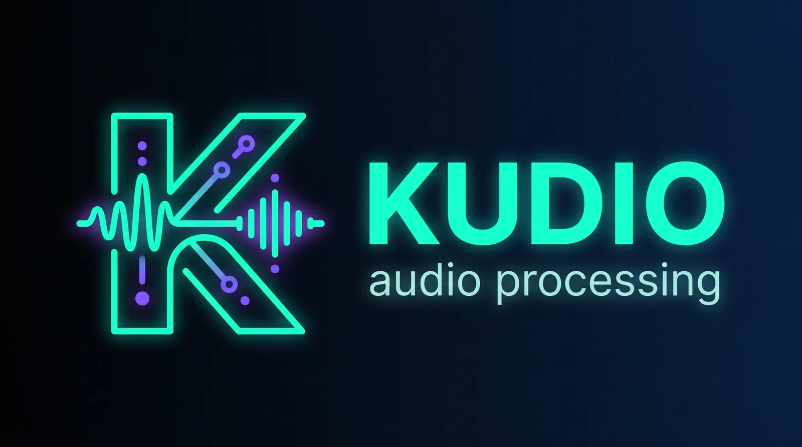

# Kudio



Kudio is a Python toolkit for audio, speech most of all. It
[reads and writes files](guide/audio-files.md),
[inspects a recording](guide/inspection.md) when there is no clean copy to
compare it with, finds [where somebody is talking and on what pitch](guide/speech.md),
[cuts, filters and augments](guide/editing.md) clips, and turns audio into
[spectrograms and model features](guide/features.md). It also
[degrades audio](guide/degradation.md) the way rooms, phone lines and lossy
links do, [builds noisy datasets](guide/synthesis.md) you can rebuild from a
seed, [denoises](guide/enhancement.md), [measures the result](guide/metrics.md)
and [records from a microphone](guide/live-audio.md), drawing or denoising the
audio while the take runs. Most of it is small functions over a numpy array
and a sample rate, so they combine in an ordinary script with nothing to set
up first.

I wrote it for preparing speech corpora and for training and judging
denoisers, and it is as much for a folder of field recordings where you need
to know which takes are usable before anybody listens to all of them. The
common jobs are also `kudio` [subcommands](cli.md), fifteen of them, from
`kudio report` to `kudio synth`. The ones that check something exit 1 when
they find a problem, so they work as tests in a shell script.

## Install

```bash
pip install kudio
pip install "kudio[eval,viz]"    # extras go in brackets, by name
```

The core install brings numpy, scipy, librosa, soundfile, PyYAML, tqdm and
PyWavelets, and runs on Python 3.9 or newer. The extras are `[viz]` for
plotting, `[eval]` for STOI, ESTOI and SDR, `[pesq]` for PESQ, `[dnsmos]` for
DNSMOS, `[data]` for dataframe and Excel export, and `[audio]` for recording
and playback. `[all]` installs every one of them except `[pesq]`, which
compiles C code. [Getting started](getting-started.md) lists what each extra
brings in.

## A short tour

A noisy recording, checked, denoised and scored. The two files are a synthetic
pair, which is the only reason a clean reference exists to score against. Open
the block below and run it first, in an empty folder, to make them.

??? example "Make `clean.wav` and `noisy.wav`"

    ```python
    import numpy as np
    import kudio

    sr = 16000
    t = np.arange(4 * sr) / sr
    f0 = 120 + 20 * np.sin(2 * np.pi * 0.5 * t)               # a pitch that wanders
    phase = 2 * np.pi * np.cumsum(f0) / sr
    voice = sum(np.sin(k * phase) / k for k in range(1, 20))  # 19 harmonics
    syllables = np.clip(np.sin(2 * np.pi * 1.5 * t), 0, None)  # sound, pause, sound...
    clean = (0.1 * voice * syllables).astype(np.float32)

    hiss = np.random.default_rng(7).standard_normal(len(clean))
    noisy = kudio.add_noise_snr(clean, hiss, snr_db=0, seed=0)  # as loud as the voice

    kudio.save_wave("clean.wav", clean, sr)
    kudio.save_wave("noisy.wav", noisy, sr)
    ```

    A buzz whose pitch drifts between 100 and 140 Hz, cut into syllables a
    third of a second long with pauses of the same length between them, and
    white noise mixed in by [`add_noise_snr`][kudio.effects.augment.add_noise_snr]
    at the same power as the voice. The pauses are deliberate. The noise
    estimators learn the noise from the quiet parts, and a clip with none gives
    them very little to learn from.

=== "Python"

    ```python
    import kudio

    y, sr = kudio.file_load("noisy.wav")           # float32 mono, at the file's own rate

    report = kudio.audio_report(y, sr)             # level, clipping, noise floor, bandwidth
    print(report)
    for problem in report.problems():
        print(problem)

    denoised = kudio.spectral_enhance(y, sr)       # log-MMSE over an MCRA noise estimate
    kudio.save_wave("denoised.wav", denoised, sr)  # 16-bit PCM unless you ask otherwise

    ref, _ = kudio.file_load("clean.wav")          # the clean half of the pair
    for name, audio in [("noisy", y), ("denoised", denoised)]:
        s = kudio.score(ref, audio, sr, ["si_sdr", "snr"])
        print(f"{name:<9} SI-SDR {s['si_sdr']:+5.1f} dB   SNR {s['snr']:+5.1f} dB")
    ```

    ```text title="Output"
    4.00s @ 16000 Hz · peak -10.1 dBFS · -22.8 LUFS · SNR~7 dB · bandwidth 8000 Hz
    estimated SNR around 7 dB — the noise floor is close to the content
    noisy     SI-SDR  +0.0 dB   SNR  +0.0 dB
    denoised  SI-SDR  +8.3 dB   SNR  +8.9 dB
    ```

=== "Command line"

    ```bash
    kudio report noisy.wav                        # exits 1: it found something
    ```

    ```text title="Output"
    4.00s @ 16000 Hz · peak -10.1 dBFS · -22.8 LUFS · SNR~7 dB · bandwidth 8000 Hz

    · estimated SNR around 7 dB — the noise floor is close to the content

    (This is a technical check. A perceptual score with no reference needs a trained model — see kudio.dnsmos.)
    ```

    ```bash
    kudio enhance noisy.wav denoised.wav          # the defaults the Python tab used
    ```

    ```text title="Output"
    log-MMSE + mcra noise estimate -> denoised.wav
      noise floor -27.3 -> -46.4 dBFS
    ```

    ```bash
    kudio align clean.wav denoised.wav --metrics  # the offset first, then the score
    ```

    ```text title="Output"
    already aligned, correlation 0.934
    overlap     4.000s of 4.000s / 4.000s

    si_sdr          8.34 dB  as the files sit
                    8.34 dB  aligned
    ```

[`audio_report`][kudio.core.report.audio_report] works from the recording
alone, which is all you have of a real one, and
[`problems()`][kudio.core.report.AudioReport.problems] keeps the findings worth
acting on. Its SNR compares the loud frames with the quiet ones, so it says
7 dB for a pair mixed at 0 dB; [Getting started](getting-started.md) shows
where the difference comes from. How the recording would sound to a listener
is another question, which [`dnsmos`][kudio.core.dnsmos.dnsmos] predicts, also
without a reference. It needs the `[dnsmos]` extra and the DNS-Challenge
weights, and kudio does not ship those.

The pairing in the comment is the default of
[`spectral_enhance`][kudio.enhance.spectral.spectral_enhance] and one of 28:
seven gain rules, each over any of four noise estimators. Choosing between
them for your own recordings is what [Denoising](guide/enhancement.md) is
about.

[`score`][kudio.core.evaluator.score] measures SI-SDR and SNR by comparing
sample *i* of the reference with sample *i* of the other signal, so the pair
has to line up. This one does: it was made that way, and `spectral_enhance`
returns exactly as many samples as it was given, none of them moved. For a
pair that may not line up, [`align`][kudio.core.align.align] finds the offset
and trims both to the part they share, which `kudio align --metrics` in the
Command line tab did before scoring. Which metric to use, and which ones need
an extra, is on [Measuring quality](guide/metrics.md).

## Where to go next

<div class="grid cards" markdown>

-   __[Getting started](getting-started.md)__

    ---

    Installing kudio and its extras, one noisy recording taken from file to
    scored result, and what kudio's errors and logging look like.

-   __[User guide](guide/index.md)__

    ---

    One page per job, from reading files to recording from a microphone,
    with the reasoning behind each tool and the places it can catch you out.

-   __[Command line](cli.md)__

    ---

    The `kudio` command and its subcommands, what they print, and when they
    exit non-zero.

-   __[API reference](reference/index.md)__

    ---

    Every public name, module by module, with its full signature and
    parameters, and an index of every name `import kudio` gives you,
    grouped by topic.

</div>

## What kudio refuses, and what it does quietly

A wrong result usually looks like a right one. These are the places where
kudio warns or refuses instead of handing one back:

- [`score`][kudio.core.evaluator.score],
  [`AudioEvaluate`][kudio.core.evaluator.AudioEvaluate] and the metric
  functions that need nothing installed warn when two signals differ in
  length, and raise a `ValueError` once more than half of the longer one would
  go unmeasured ([`MAX_LENGTH_MISMATCH`][kudio.core.evaluator.MAX_LENGTH_MISMATCH]).
  [`compare_enhancers`][kudio.enhance.spectral.compare_enhancers] and `pesq`
  check a reference the same way, and every metric refuses a stereo pair
  rather than score both channels as one signal.
- [`pesq`][kudio.core.evaluator.pesq] raises a `ValueError` for any rate but 8
  and 16 kHz rather than resample behind your back, and for a combination the
  standards do not define, such as a raw wideband score.
- [`save_wave`][kudio.core.io.save_wave] refuses a waveform holding NaN or inf
  with an [`AudioIOError`][kudio.exceptions.AudioIOError], in every format.
  Written as `FLOAT`, a NaN would reach every program that reads the file; in
  an integer format it would become an ordinary sample value, and nothing
  downstream would know the clip was broken. The loudness functions measure
  such a clip as `nan` with a warning, never as the `-inf` of silence, and
  `normalize_lufs` and `match_loudness` refuse it.
- [`StreamEnhancer`][kudio.enhance.streaming.StreamEnhancer] raises a
  [`FeatureError`][kudio.exceptions.FeatureError] for `specsub`, `multiband`,
  `spectral_gate` and the `quantile` noise estimator, which work on the whole
  spectrogram at once, instead of running something that only shares their
  name.

A `ValueError` is not a [`KudioError`][kudio.exceptions.KudioError], so
`except kudio.KudioError` lets those through. A missing extra raises a
[`DependencyError`][kudio.exceptions.DependencyError], which is an
`ImportError` as well, naming the `pip install` to run.
[Getting started](getting-started.md) has every exception class and what
raises it.

These happen without a word:

- [`file_load`][kudio.core.io.file_load] averages the channels of a
  multichannel file into one unless you pass `mono=False`.
- In the integer formats, the default 16-bit PCM included, `save_wave` clips
  anything past ±1.0 to full scale. Write `subtype="FLOAT"` when a mix might
  run hot. [`Synthesizer`][kudio.core.synth.Synthesizer] is the exception:
  `syn()` warns when a mix went past full scale, and `.clipped` names the
  files.
- At its defaults `pesq` reports wideband MOS-LQO at 16 kHz. The raw
  narrowband P.862 score is a different number for the same file, and even
  the narrowband MOS-LQO puts a raw 2.0 at about 1.6, so check which one a
  paper quotes before comparing with it. `mode=` and `scale=` choose, or
  `pesq_mode=` and `pesq_scale=` through `score` and `AudioEvaluate`.
- kudio logs its bookkeeping to the `kudio.*` loggers and prints none of it
  until your program configures `logging`: a file about to be overwritten, an
  output folder emptied, a list entry passed over. Trouble with the audio
  itself, such as NaN in a file or
  [`normalize_lufs`][kudio.core.loudness.normalize_lufs] pushing a peak past
  full scale, comes as a Python warning, which shows anyway. I start anything
  that runs unattended with `logging.basicConfig(level=logging.WARNING)`.

Anything that draws random numbers takes a seed: where the noise is cropped in
a [mixed corpus](guide/synthesis.md), a generated room or a packet-loss
pattern from [Rooms and channels](guide/degradation.md), a
train/validation/test split. Every one of them defaults to `seed=None`, which
draws a fresh one on each run, so pass one. A `Synthesizer` run made without a
seed keeps the one it drew in `.seed`, so that corpus can still be rebuilt.

## Related projects

Two more of my projects are built on kudio. Neither is on PyPI; each installs
from a clone of its GitHub repository.

[KudioStudio](https://github.com/recklight/KudioStudio)
:   A desktop workbench over kudio, written with PySide6. Open a clip, look at
    it, edit it, denoise it, measure it and build a dataset from it without
    writing a script first. Every control maps to one kudio function, and the
    caption under each panel shows the exact call it will make, so whatever
    you settle on there carries straight over to code.

[KudioEnhance](https://github.com/recklight/KudioEnhance) (`kudio-enhance`)
:   Trains learned denoisers on log-power spectrograms with PyTorch: a dense
    denoising autoencoder, a bidirectional LSTM, a dilated convolutional
    autoencoder, a causal convolutional recurrent network and a 2-D U-Net. Its
    training data is mixed by
    [`Synthesizer`][kudio.core.synth.Synthesizer], and a trained model can go
    into [`compare_enhancers`][kudio.enhance.spectral.compare_enhancers] next
    to the statistical methods, scored against the same reference.
