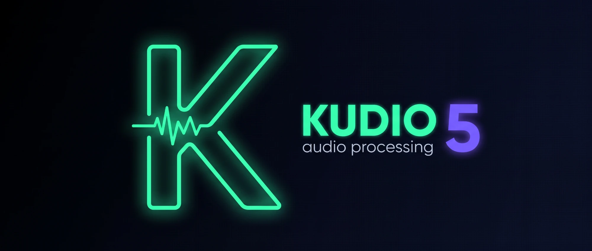

# Kudio



Kudio is a Python library for audio, speech most of all. It
[reads and writes files](guide/audio-files.md),
[checks a recording](guide/inspection.md) with no clean copy to compare it
with, finds [speech and its pitch](guide/speech.md),
[edits and augments](guide/editing.md) clips, computes
[spectrograms and model features](guide/features.md),
[degrades audio](guide/degradation.md) the way rooms and phone lines do,
[builds noisy datasets](guide/synthesis.md), [denoises](guide/enhancement.md),
[measures quality](guide/metrics.md) and [records](guide/live-audio.md). Most
of it is functions over a numpy array and a sample rate.

The metrics are the ones speech papers report, from PESQ, STOI and SI-SDR to
DNSMOS with no reference and the error rates of [recognizers, verifiers and
pitch trackers](guide/task-metrics.md); [How the metrics are checked](validation.md)
names each one's reference. `kudio score` takes a test set to the table a paper
needs: means with confidence intervals, a test against a baseline, a
[signature](guide/metrics.md#signing-a-result) and the BibTeX behind the numbers.

## Install

```bash
pip install kudio
pip install "kudio[audio,viz]"    # extras go in brackets, by name
```

Python 3.9 or newer. [Getting started](getting-started.md#extras) lists the
extras.

## A short tour

A noisy recording, checked, denoised and scored against the clean signal it
was made from. Run the first block in an empty folder to make the pair.

??? example "Make `clean.wav` and `noisy.wav`"

    ```python
    import numpy as np
    import kudio

    sr = 16000
    t = np.arange(4 * sr) / sr
    f0 = 120 + 20 * np.sin(2 * np.pi * 0.5 * t)               # a pitch that wanders
    phase = 2 * np.pi * np.cumsum(f0) / sr
    voice = sum(np.sin(k * phase) / k for k in range(1, 20))  # 19 harmonics
    syllables = np.clip(np.sin(2 * np.pi * 1.5 * t), 0, None)  # sound, pause, sound...
    clean = (0.1 * voice * syllables).astype(np.float32)

    hiss = np.random.default_rng(7).standard_normal(len(clean))
    noisy = kudio.add_noise_snr(clean, hiss, snr_db=0, seed=0)  # as loud as the voice

    kudio.save_wave("clean.wav", clean, sr)
    kudio.save_wave("noisy.wav", noisy, sr)
    ```

```python
import kudio

y, sr = kudio.file_load("noisy.wav")           # float32 mono, at the file's own rate

report = kudio.audio_report(y, sr)             # level, clipping, noise floor, bandwidth
print(report)

denoised = kudio.spectral_enhance(y, sr)       # log-MMSE over an MCRA noise estimate
kudio.save_wave("denoised.wav", denoised, sr)  # 16-bit PCM unless you ask otherwise

ref, _ = kudio.file_load("clean.wav")
for name, audio in [("noisy", y), ("denoised", denoised)]:
    s = kudio.score(ref, audio, sr, ["si_sdr", "snr"])
    print(f"{name:<9} SI-SDR {s['si_sdr']:+5.1f} dB   SNR {s['snr']:+5.1f} dB")
```

```text
4.00s @ 16000 Hz · peak -10.1 dBFS · -22.8 LUFS · SNR~7 dB · bandwidth 8000 Hz
noisy     SI-SDR  +0.0 dB   SNR  +0.0 dB
denoised  SI-SDR  +8.3 dB   SNR  +8.9 dB
```

The same from a shell, where `report` exits 1 when it finds a problem:

```bash
kudio report noisy.wav
kudio enhance noisy.wav denoised.wav
kudio align clean.wav denoised.wav --metrics
```

## Where to go next

- [Getting started](getting-started.md): the extras, one recording from file to
  score, and what kudio raises and logs.
- [User guide](guide/index.md): one page per job, from reading files to
  recording from a microphone.
- [Command line](cli.md): the `kudio` subcommands and their exit codes.
- [API reference](reference/index.md): every public name with its parameters.

## Related projects

[KudioStudio](https://github.com/recklight/KudioStudio) (`pip install kudiostudio`)
:   A desktop workbench over kudio, each panel showing the kudio call it makes.

[KudioEnhance](https://github.com/recklight/KudioEnhance) (`pip install kudioenhance`)
:   Learned denoisers in PyTorch. Its training data is mixed by
    [`Synthesizer`][kudio.core.synth.Synthesizer], and a trained model goes into
    [`compare_enhancers`][kudio.enhance.spectral.compare_enhancers] next to the
    statistical methods.
