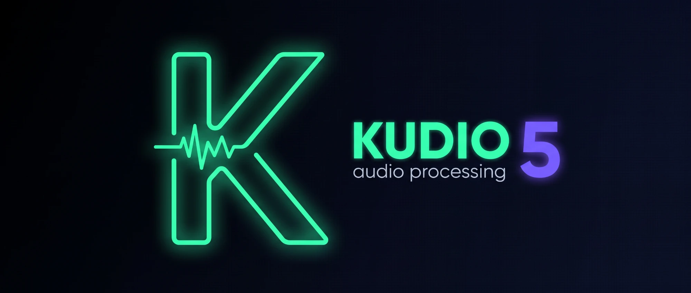

# Kudio



Kudio 是處理音訊的 Python 函式庫，主要對象是語音。它能[讀寫檔案](guide/audio-files.md)、
在沒有乾淨版本可比對時[檢查一段錄音](guide/inspection.md)、找出[語音和它的音高](guide/speech.md)、
[剪輯與擴增](guide/editing.md)片段、算[頻譜圖和模型特徵](guide/features.md)、
像房間和電話線那樣[劣化音訊](guide/degradation.md)、[建立含雜訊的資料集](guide/synthesis.md)、
[降噪](guide/enhancement.md)、[品質評估](guide/metrics.md)和[錄音](guide/live-audio.md)。
大部分是吃 numpy 陣列和取樣率的函式。

指標是語音論文會報的那些，從 PESQ、STOI、SI-SDR，到不需參考訊號的 DNSMOS，以及
[語音辨識、語者驗證和音高追蹤](guide/task-metrics.md)的錯誤率；[指標驗證](validation.md)
列出每個指標的對照對象。`kudio score` 把測試集算成論文要的表：平均值和信賴區間、對基準的
檢定、[簽章](guide/metrics.md#signing-a-result)，以及數字背後文獻的 BibTeX。

## 安裝 {#install}

```bash
pip install kudio
pip install "kudio[audio,viz]"    # extras go in brackets, by name
```

需要 Python 3.9 以上。[入門](getting-started.md#extras)列出所有選用套件組。

## 快速導覽 {#a-short-tour}

一段有雜訊的錄音：檢查、降噪，再和產生它的乾淨訊號比對評分。先在空資料夾裡執行第一段，
做出這一對檔案。

??? example "產生 `clean.wav` 和 `noisy.wav`"

    ```python
    import numpy as np
    import kudio

    sr = 16000
    t = np.arange(4 * sr) / sr
    f0 = 120 + 20 * np.sin(2 * np.pi * 0.5 * t)               # a pitch that wanders
    phase = 2 * np.pi * np.cumsum(f0) / sr
    voice = sum(np.sin(k * phase) / k for k in range(1, 20))  # 19 harmonics
    syllables = np.clip(np.sin(2 * np.pi * 1.5 * t), 0, None)  # sound, pause, sound...
    clean = (0.1 * voice * syllables).astype(np.float32)

    hiss = np.random.default_rng(7).standard_normal(len(clean))
    noisy = kudio.add_noise_snr(clean, hiss, snr_db=0, seed=0)  # as loud as the voice

    kudio.save_wave("clean.wav", clean, sr)
    kudio.save_wave("noisy.wav", noisy, sr)
    ```

```python
import kudio

y, sr = kudio.file_load("noisy.wav")           # float32 mono, at the file's own rate

report = kudio.audio_report(y, sr)             # level, clipping, noise floor, bandwidth
print(report)

denoised = kudio.spectral_enhance(y, sr)       # log-MMSE over an MCRA noise estimate
kudio.save_wave("denoised.wav", denoised, sr)  # 16-bit PCM unless you ask otherwise

ref, _ = kudio.file_load("clean.wav")
for name, audio in [("noisy", y), ("denoised", denoised)]:
    s = kudio.score(ref, audio, sr, ["si_sdr", "snr"])
    print(f"{name:<9} SI-SDR {s['si_sdr']:+5.1f} dB   SNR {s['snr']:+5.1f} dB")
```

```text
4.00s @ 16000 Hz · peak -10.1 dBFS · -22.8 LUFS · SNR~7 dB · bandwidth 8000 Hz
noisy     SI-SDR  +0.0 dB   SNR  +0.0 dB
denoised  SI-SDR  +8.3 dB   SNR  +8.9 dB
```

在 shell 裡也一樣，`report` 找到問題時結束碼是 1：

```bash
kudio report noisy.wav
kudio enhance noisy.wav denoised.wav
kudio align clean.wav denoised.wav --metrics
```

## 接下來看哪裡 {#where-to-go-next}

- [入門](getting-started.md)：選用套件組、一段錄音從檔案到評分，以及 kudio 會丟出和記錄什麼。
- [使用指南](guide/index.md)：一件工作一頁，從讀檔到用麥克風錄音。
- [命令列](cli.md)：`kudio` 的子指令和結束碼。
- [API 參考](reference/index.md)：每個公開名稱和它的參數。

## 相關專案 {#related-projects}

[KudioStudio](https://github.com/recklight/KudioStudio)（`pip install kudiostudio`）
:   建在 kudio 上的桌面工作台，每個面板都顯示它呼叫的 kudio 函式。

[KudioEnhance](https://github.com/recklight/KudioEnhance)（`pip install kudioenhance`）
:   用 PyTorch 訓練的降噪模型。訓練資料由 [`Synthesizer`][kudio.core.synth.Synthesizer]
    混出來，訓練好的模型可以放進 [`compare_enhancers`][kudio.enhance.spectral.compare_enhancers]，
    和統計方法一起比。
